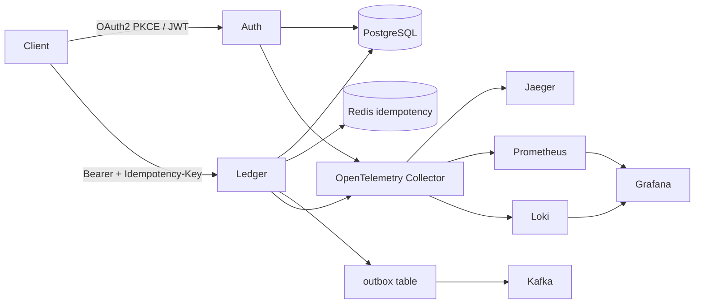

# Real-Time Payments Ledger

Double-entry financial ledger in Go: idempotent transfers, row-level locking under `SERIALIZABLE` isolation, an append-only audit journal, Kafka via a transactional outbox, OAuth2 PKCE + JWT, and OpenTelemetry (Jaeger, Prometheus, Grafana, Loki).

This is the kind of system Stripe-style interviews probe: **correctness under retries**, **no negative balances under concurrency**, and **you can prove it with traces**.

## Architecture



A transfer is one Postgres transaction:

1. Claim the idempotency key (Redis `SET NX` + durable row in Postgres, 24h TTL).
2. `SELECT ... FOR UPDATE` both accounts **in UUID order** (no ABBA deadlocks).
3. Reject if a user wallet would go negative.
4. Write two journal lines (debit source, credit destination) so the posting always balances.
5. Append immutable `audit_log` rows (UPDATE/DELETE are blocked by trigger).
6. Insert a Kafka payload into `outbox` in the **same** commit.
7. Background publisher ships outbox rows to Kafka (at-least-once).

Invariant: **sum of all account balances is 0** (issuance wallet holds the negative of customer float). User wallets cannot go below zero.

## Stack

| Layer | Choice |
|---|---|
| Language | Go |
| Database | PostgreSQL (`SERIALIZABLE` + `FOR UPDATE`) |
| API | gRPC Protobuf contract + HTTP/REST gateway (`/v1/*`) |
| Idempotency | Redis + Postgres, Stripe-style key + request fingerprint |
| Events | Kafka via transactional outbox |
| Auth | OAuth2 authorization code + PKCE (S256), JWT access, rotating refresh tokens |
| Observability | OpenTelemetry → Jaeger, Prometheus, Grafana, Loki |
| Chaos | Toxiproxy in front of Postgres and Redis |
| CI/CD | GitHub Actions: test → vet → lint → Docker build |
| Deploy | Docker Compose locally; Kubernetes manifests + Helm chart |

## Quick start

```bash
docker compose up --build
```

Services:

- Auth HTTP: http://localhost:8081 (`ALLOW_DEV_TOKEN=true` in Compose)
- Ledger HTTP: http://localhost:8080
- Jaeger UI: http://localhost:16686
- Grafana: http://localhost:3000 (anonymous admin)
- Prometheus: http://localhost:9093
- Toxiproxy API: http://localhost:8474

Demo users (each seeded with **$10,000.00** = `1000000` cents):

- `alice@ledger.dev` / `password`
- `bob@ledger.dev` / `password`

Account UUIDs are printed in the ledger container logs at startup (`alice_account`, `bob_account`).

### 1. Get a token (local/dev)

```bash
curl -s http://localhost:8081/oauth/dev-token \
  -H 'Content-Type: application/json' \
  -d '{"email":"alice@ledger.dev","password":"password"}'
```

PKCE (production-shaped) flow:

1. `GET /oauth/pkce` → `code_verifier` + `code_challenge`
2. Browser: `GET /oauth/authorize?client_id=ledger-cli&redirect_uri=http://localhost:8080/callback&code_challenge=...&code_challenge_method=S256&state=xyz`
3. `POST /oauth/token` with `grant_type=authorization_code`, `code`, `code_verifier`

### 2. Transfer (retry-safe)

```bash
TOKEN=...
FROM=...
TO=...

curl -s http://localhost:8080/v1/transfers \
  -H "Authorization: Bearer $TOKEN" \
  -H "Idempotency-Key: $(uuidgen)" \
  -H 'Content-Type: application/json' \
  -d "{\"from_account_id\":\"$FROM\",\"to_account_id\":\"$TO\",\"amount_minor\":500,\"currency\":\"USD\"}"
```

Send the **same** `Idempotency-Key` and body again: HTTP 200, `replayed: true`, same `transaction_id`. Change the body with the same key: HTTP 422.

### 3. Audit log

```bash
curl -s http://localhost:8080/v1/accounts/$FROM/audit \
  -H "Authorization: Bearer $TOKEN"
```

### 4. Concurrent load

```bash
FROM_ACCOUNT=$FROM TO_ACCOUNT=$TO go run ./cmd/loadtest
```

Runs 1,000 alternating Alice↔Bob $0.01 transfers. Property tests (`go test ./internal/ledger -count=1`) assert non-negative user balances and sum conservation when `DATABASE_URL` is set.

### 5. Chaos

Ledger reaches Postgres/Redis through Toxiproxy. Inject latency or dropped connections, retry the same idempotency key, then clear toxics:

```bash
go run ./cmd/chaos
```

See `chaos/README.md` for the 12 scenarios.

## API (REST gateway ≡ proto)

Defined in `proto/ledger/v1/ledger.proto` and `proto/auth/v1/auth.proto`.

| Method | Path | Notes |
|---|---|---|
| POST | `/v1/transfers` | Requires `Idempotency-Key` |
| GET | `/v1/accounts/{id}` | |
| POST | `/v1/accounts` | |
| GET | `/v1/transactions/{id}` | |
| GET | `/v1/accounts/{id}/audit` | Append-only history |
| POST | `/oauth/token` | `authorization_code` or `refresh_token` |
| POST | `/oauth/introspect` | |

gRPC listens on `:9090` (ledger) and `:9091` (auth) with health + reflection. Generate stubs with `buf generate` from the proto files.

## Tests

```bash
go test ./...
```

- `testing/quick` fingerprints and random transfer sequences
- Concurrent Alice↔Bob transfers
- Idempotent replay + fingerprint conflict
- PKCE S256 round-trip

CI (`.github/workflows/ci.yml`) runs tests against Postgres + Redis, `go vet`, golangci-lint, and Docker image builds.

## Kubernetes

```bash
helm upgrade --install payments deployments/helm/payments-ledger
```

Manifests also live under `deployments/k8s/`. Create a `ledger-secrets` Secret with `database-url`, `redis-addr`, `kafka-brokers`, and `jwt-signing-key`. Probes hit `/healthz`; CPU/memory limits are set on both deployments.

## Project layout

```
cmd/auth cmd/ledger cmd/loadtest cmd/chaos
internal/ledger      # posting + locking + retries on 40001/40P01
internal/idempotency # Redis + Postgres, Stripe-style
internal/authn       # PKCE, JWT, refresh rotation
internal/outbox      # Kafka publisher
proto/               # gRPC/Protobuf contracts
migrations/          # append-only journal + audit triggers
observability/       # collector, Prometheus, Grafana
deployments/         # Docker, Helm, raw YAML
```
